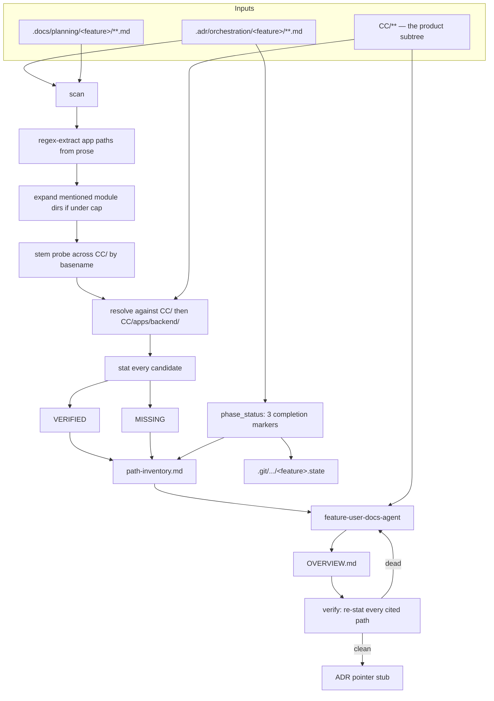
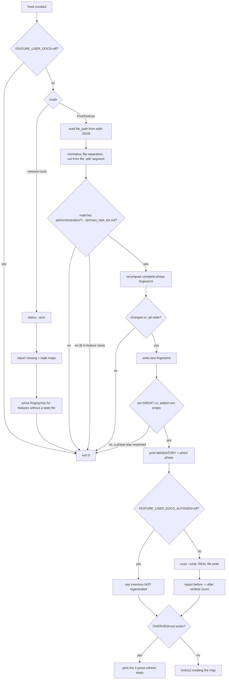

# Architecture: Feature User Docs

## Component map

```
.claude/
├── agents/feature-user-docs-agent/AGENT.md          # Writes the prose map; hard constraints
├── skills/feature-user-docs/
│   ├── SKILL.md                                     # Workflow, home decision, honest auto-fire
│   ├── references/
│   │   ├── overview-template.md                     # Required OVERVIEW.md shape + group order
│   │   ├── adr-pointer-stub.md                      # The 4-line ADR cross-link
│   │   └── sync-manifest.md                         # What syncs, what stays local
│   └── scripts/feature-user-docs.py                 # scan | verify | status | list-features
├── hooks/scripts/feature-user-docs-detect.sh        # PostToolUse + SessionStart(--session-scan)
├── commands/feature-user-docs.md                    # /feature-user-docs with $ARGUMENTS
└── system_docs/feature_user_docs/                   # this doc set

.docs/planning/<feature>/user-docs/                  # OUTPUT — the home
├── OVERVIEW.md                                      #   model-authored reading map
└── path-inventory.md                                #   script-generated path ledger

.adr/orchestration/<feature>/user-docs/README.md     # OUTPUT — pointer stub only

.git/feature-user-docs/<feature>.state               # STATE — complete-phase fingerprint (untracked)
```

## Data flow



## Path discovery algorithm

```
1. Walk .adr/orchestration/<feature>/** and .docs/planning/<feature>/**
   - collect *.md as docs (EXCLUDING any user-docs/ dir — the map must not feed itself)
   - collect images/pdf/html as evidence

2. For every doc, regex-extract candidate app paths:
     (CC/)?(apps|packages|sql|scripts|.app-docs)/…\.(tsx|ts|mjs|js|sql|jsonc|json|md|yaml|yml|css|html)
   - extension alternation is LONGEST-FIRST: `ts|tsx` would match the `.ts` of
     `Automations.tsx` and manufacture a dead path

3. For every doc, regex-extract mentioned DIRECTORIES ((apps|packages)/…/ with depth >= 3)
   - if the dir exists AND holds <= expand_cap code files (default 30): add every file in it
     → surfaces this feature's own module siblings that no doc named
   - else: record it under "Large modules touched but NOT expanded" and move on
     → an 80-file pre-existing module must not bury the map

4. Derive feature stems: expanded module/feature dir names, plus `add_<stem>.sql` and
   `ensure-<stem>.ts` basenames. Keep stems >= 6 chars.
   Sweep CC/** once (skipping node_modules/dist/build/.git/.turbo/coverage/.next/out) and add any
   file whose BASENAME contains a stem.
     → this is the ONLY way the map reaches files spread by naming convention rather than by
       directory: `email-campaigns-api.ts`, `use-email-campaigns-mutations.ts`,
       `email-campaigns-schema.ts`, `add_email_campaigns.sql`

5. Resolve each candidate against the bases ("", "apps/backend") and take the first that exists
     → a bare `sql/add_x.sql` in a doc is written relative to the backend app, not the subtree root

6. stat() everything. exists → VERIFIED (grouped); absent → MISSING (reported with its citing docs)
```

## Grouping heuristic

Applied to each verified path, in order; first match wins.

| Test on the path | Group |
|---|---|
| basename ends `.spec.ts(x)` / `.test.ts(x)` | `tests` |
| contains `/.app-docs/` | `conventions` |
| contains `/sql/`, `/src/db/`, or `/scripts/ensure-` | `schema` |
| contains `/apps/admin-panel/` | `admin_ui` |
| contains `/apps/listing/` | `storefront` |
| contains `/src/config/` or `/src/scheduler/`, or basename is `index.ts` / `package.json` | `wiring` |
| contains `/src/modules/` or `/packages/` | `backend` |
| anything else | `other` |

Note the ordering is load-bearing: a `.spec.ts` inside `src/modules/` is a test, not backend; a
`src/db/*.ts` is schema, not backend.

## Phase-completion detection

```
COMPLETE if ANY of:

  1. lines[0:6] match   ^> \*\*STATUS: ((CORE|BACKEND|PARTIAL|FULLY) )?(DONE|COMPLETE)\b
  2. lines[0:24] match  ^\s*Status:\s*\*{0,2}(complete|done)\b
       anchored at the START of the value, so
       `Status:  in_progress (phases 01-07 complete; …)` does NOT match
  3. a `## Outcome` heading whose (date) is present, or whose first ~7 body lines are
       something other than `_(filled in on completion …)_`
```

Validated against the repo: f12 → 12/13 phases detected complete (the 13th is the feature root, marked
`APPROVED FOR BUILD`); f11 → 0/15 (main build predates per-phase folders; remediation + expansion
phases are scaffolded, `Status: **not started**`, Outcome placeholder).

## Hook decision tree



Path normalization is deliberately **not** prefix-stripping: the same repo root has three spellings on
this platform — `C:\Work\App\CC-Local` (hook payload), `C:/Work/App/CC-Local` (`git rev-parse`), and
`/c/Work/App/CC-Local` (MSYS `pwd`). Cutting from the `.adr/` segment is spelling-independent.

## Error handling

| Error | Trigger | Behaviour |
|---|---|---|
| No `.adr/orchestration/` | Non-ADR repo | Hook exits 0 silently; component inert. |
| Python not on PATH | Minimal environment | Hook exits 0 silently (no partial write). |
| `jq` absent | Minimal environment | Falls back to a `grep`/`sed` extraction of `file_path`. |
| Ambiguous feature token | `f2` matching two features | Script exits with the candidate list. Never guesses. |
| Unreadable / non-UTF-8 doc | Stray byte | `errors="replace"` — the scan continues rather than aborting. |
| Dead path cited in `OVERVIEW.md` | File moved after the map was written | `verify` exits 1 and names each one. The map is not "done" until clean. |
| Scanner cannot write the inventory | Permissions / locked file | Hook reports it and falls back to instructing a manual run. |
| Phase reopened (complete → not) | Status marker removed | Fingerprint updates, but nothing is announced — only growth triggers. |

## Concurrency note

`path-inventory.md` is regenerated from a filesystem walk, so two runs are identical **at a given
instant** but will differ if the product subtree changed between them. That is correct behaviour, and
the reason the inventory carries a generation timestamp and the overview carries a generated date — the
`--status` staleness check compares their mtimes.
