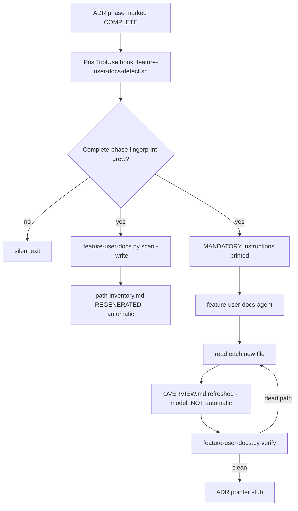

# System Docs: Feature User Docs

## Purpose

Maintains a per-feature **reading map** — `.docs/planning/<feature>/user-docs/OVERVIEW.md` — that lists
the FULL absolute path to every pertinent file for that feature, each with one or two sentences saying
what the file is, what to read in it, and why it matters. Orientation, not explanation: it answers
"which files do I open, in what order, and why" for a reader with zero context.

> **Not to be confused with `user_docs`** (`.codex/system_docs/user_docs/`), which is the `.appdocs/`
> visual end-user documentation system (Playwright screenshots, HTML viewers, user guides). That system
> documents the *product for its users*. This system documents a *feature's source tree for a developer*.
> Different audience, different output, no overlap.

## Components

| Component | Path |
|-----------|------|
| Agent | `.codex/agents/feature-user-docs-agent/AGENT.md` |
| Skill | `.codex/skills/feature-user-docs/SKILL.md` |
| Script | `.codex/skills/feature-user-docs/scripts/feature-user-docs.py` |
| References | `.codex/skills/feature-user-docs/references/{overview-template,adr-pointer-stub,sync-manifest}.md` |
| Hook | `.codex/hooks/scripts/feature-user-docs-detect.sh` (SessionStart + PostToolUse) |
| Command | `.codex/commands/feature-user-docs.md` |
| Output (home) | `.docs/planning/<feature>/user-docs/{OVERVIEW.md,path-inventory.md}` |
| Output (pointer) | `.adr/orchestration/<feature>/user-docs/README.md` |
| State | `.git/feature-user-docs/<feature>.state` (untracked fingerprints) |

## Where `user-docs/` lives, and why

**Home: `.docs/planning/<feature>/user-docs/`.**

| Tree | What it holds | Audience |
|---|---|---|
| `.docs/planning/<feature>/` | README, prd, feature-explained, research, keys-explained, user-testing-instructions, `guides/`, `tests/` | **Humans** |
| `.adr/orchestration/<feature>/` | prd, technical_requirements, notes, per-phase `primary_task_list.md` with `## Outcome`, evidence | **The implementation record** |

A reading map is human-facing orientation, so it belongs with the other human-facing docs — the planning
tree, already owned by the `feature-planning-spec` convention. The ADR tree is a record of work
performed, phase by phase; an orientation doc there would mix audiences and compete with the Outcome
sections for the same job.

**Cross-link:** a 4-line pointer stub is written at `.adr/orchestration/<feature>/user-docs/README.md`
so an agent working in the ADR tree still finds the map. It is pointer-only — map content is **never**
duplicated across the two trees, because two copies of a reading map drift, and a drifted map is exactly
the failure this component exists to prevent.

## Architecture

## Auto-fire — exactly what is automatic

Claude Code hooks fire on **events**, never on arbitrary repo state. So "regenerate on ADR phase
completion" is split honestly:

| Half | Mechanism | Genuinely automatic? |
|---|---|---|
| `path-inventory.md` | the hook runs the scanner and **writes the file** | **YES** — deterministic walk + regex + `stat`, no model |
| `OVERVIEW.md` prose | the hook prints MANDATORY instructions naming the completed phase and the path delta | **NO** — detect-and-instruct; annotating files requires reading them |

**Never claim the overview auto-regenerates.** It does not.

## Completion signal

A phase is COMPLETE when its `primary_task_list.md` shows any one of the three spellings this repo
actually uses:

1. `> **STATUS: [CORE|BACKEND|PARTIAL] (DONE|COMPLETE) …**` — the leading blockquote
2. `Status:  complete` — the metadata line (bare or inside the header fence), anchored so
   `in_progress (phases 01-07 complete…)` does **not** match
3. `## Outcome (YYYY-MM-DD)` or an Outcome body that is not the scaffold placeholder

Not complete: `PLANNED`, `APPROVED FOR BUILD`, `IN PROGRESS`, `BLOCKED`, `DEFERRED`, `NOT STARTED`,
`SCAFFOLDED`.

## Key design decisions

- **The script owns path discovery; the model owns prose.** The map's one unforgivable failure is a dead
  path, and existence checking is mechanical. So discovery + `stat` live in Python (repeatable, fast,
  deterministic), and the model does only what it can actually do — read files and say why they matter.
- **A directory is expanded only if it is small** (≤30 files, `--expand-cap`). A feature's own module
  gets its siblings surfaced; a 80-file pre-existing module is named under "Large modules touched but
  NOT expanded" instead of burying the map.
- **A stem probe sweeps the app subtree** for files whose basename carries a feature module's stem. This
  is how `use-email-campaigns-mutations.ts` reaches the map — no planning doc names it, and its
  directory (37 files) is far too large to expand. Convention finds what citation missed.
- **Unverifiable paths are reported, never guessed.** They go in `## Mentioned but not verified` with the
  doc that named them. A reading map with a dead path is worse than no map.
- **Fingerprint state lives in `.git/`** (untracked), so the hook fires once per transition rather than
  on every edit — same pattern as `.git/component-sync-pending`.

## Integration points

| System | Relationship |
|---|---|
| `feature_planning_spec` | Owns the rest of `.docs/planning/<feature>/`. This component adds `user-docs/` without disturbing its files. |
| `adr_setup` | Defines the phase lifecycle and `## Outcome` convention read as the completion signal. |
| `todo_tracker` | Also parses `primary_task_list.md` phase status, for a different output (`TODO.md`). Same signal, different consumer. |
| `cycle_back` | Same component/project-data split: the component syncs, the per-feature content stays project-local. |
| `claude_codex_sync` | Mirrors agent + skill + command + system docs into `.codex/`. |
| `component_creator` | This component was produced by its 9-step pipeline. |

## Sync

The **component** travels to `SYNC-REPOS.md` targets; the **per-feature maps** never do. Full file list
and the one portability constant (`APP_SUBTREE`) in
`.codex/skills/feature-user-docs/references/sync-manifest.md`.
