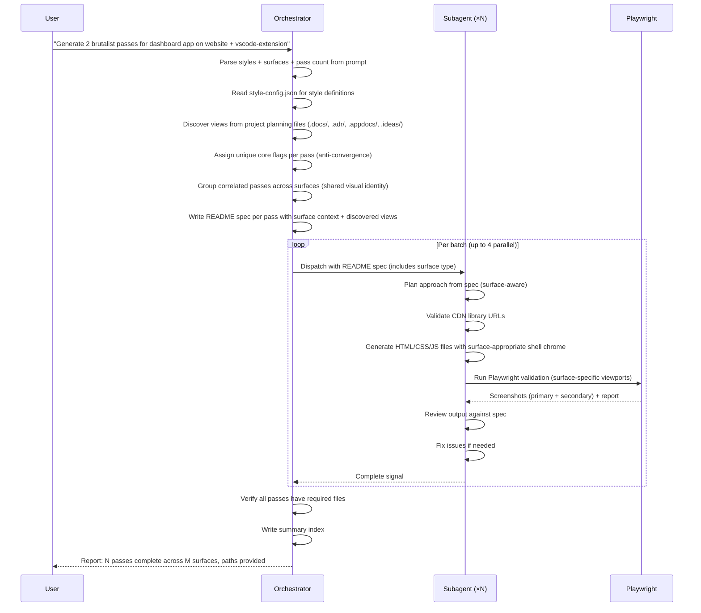

# Architecture: General Frontend Design

## Orchestrator → Subagent Flow



## Surface-Specific Viewports

Playwright validation uses viewports appropriate to the target surface:

| Surface | Primary Viewport | Secondary Viewport | Shell Chrome |
|---------|-----------------|-------------------|-------------|
| `website` | 1440×900 (desktop) | 390×844 (mobile) | Standard browser |
| `vscode-extension` | 1280×800 (IDE) | 800×600 (compact) | IDE chrome mockup (sidebar, activity bar, status bar) |
| `mobile-app` | 390×844 (phone) | 768×1024 (tablet) | System bars + bottom nav |
| `browser-extension` | 400×600 (popup) | 320×500 (sidebar) | Popup/sidebar chrome |

Screenshot directories use `primary/` and `secondary/` instead of `desktop/` and `mobile/` since viewport meaning varies by surface.

## Dynamic View Discovery

Views are not hardcoded. The orchestrator scans project planning files before dispatch:

| Source Directory | What Is Discovered |
|-----------------|-------------------|
| `.docs/` | Planning docs, feature specs, view lists |
| `.adr/` | Architecture decisions referencing views/features |
| `.appdocs/` | App documentation, user stories, screen inventories |
| `.ideas/` | Idea logs referencing proposed views |

The discovered view set is included in each subagent's README spec. View count varies per project.

## Cross-Surface Correlation Groups

When generating for multiple surfaces in one run, the orchestrator creates correlation groups:
- Correlated passes share: palette, typography, visual motifs
- Correlated passes diverge: layout structure, navigation model, chrome treatment
- Correlation is recorded in each pass's `handoff.json` under a `correlationGroup` field

## Anti-Convergence System

The orchestrator assigns uniqueness flags to prevent passes within the same style group from looking alike:

**Orchestrator-assigned (structural — prevent layout duplication):**
- Layout archetype: sidebar-driven | full-bleed-immersive | dashboard-grid | editorial-column | card-mosaic
- Navigation model: persistent-left-rail | floating-fab-menu | hamburger-drawer | top-tabs | breadcrumb-tree
- Information density: minimal | balanced | data-rich
- Animation philosophy: static | subtle | expressive
- Color temperature: warm | cool | neutral | high-contrast

**Subagent-assigned (creative — within structural constraints):**
- Typography pairing, grid system, interaction signature, visual motif, spacing rhythm, micro-interaction style

## Output File Structure

```
.docs/planning/concepts/<surface>/<style>/pass-<n>/
├── [view].html × N         # One per discovered view
├── style.css               # Shared stylesheet
├── app.js                  # Shared JavaScript
├── README.md               # Updated with subagent flags
└── validation/
    ├── handoff.json                      # Structured handoff data (includes correlationGroup)
    ├── inspiration-crossreference.json   # Reference sites used
    ├── report.playwright.json            # Playwright test results
    ├── primary/
    │   ├── showcase.png
    │   └── showcase-viewport.png
    └── secondary/
        ├── showcase.png
        └── showcase-viewport.png
```

## Subagent Self-Validation Loop

Each subagent runs its own validation cycle before reporting complete:

```
Generate → Validate (Playwright, surface-specific viewports) → Review results → Fix issues → Re-validate → Done
```

Subagent does not mark complete until Playwright screenshots confirm visual output at the correct surface viewports.

## Error Handling

| Error | Trigger | Action |
|-------|---------|--------|
| CDN library 404 | Validation fetches fail | Try alternate CDN; use local equivalent |
| Playwright screenshot blank | Rendering error | Check browser console, fix JS errors |
| Pass convergence detected | Two passes share layout archetype | Reassign orchestrator flags before dispatch |
| Missing required files | Pass has fewer files than expected at completion | Orchestrator flags pass as incomplete |
| Subagent exceeds context | Very large pass with many files | Split into two subagent calls |
| Unknown surface type | Surface not in supported list | Reject with error listing valid surfaces |
| View discovery finds no views | No planning files or empty project | Fall back to default view set with warning |
| Surface viewport mismatch | Screenshots taken at wrong dimensions | Re-run Playwright with correct surface viewports |
| Mode switcher covers a control | Fixed button sits on a fixed bar or the last control | Reserve bottom padding, move it above the bar, or tuck it to an edge tab |
| A mode or role does not open | `?mode=`/`&role=` not read, or the id differs from handoff.json | Reuse the state logic in references/mode-switcher.md; match ids |
| Sign-in or sign-out check fails | Form lacks `data-mock-signin`, or no `data-mock-signout` control | Add the hooks from references/mode-switcher.md |
