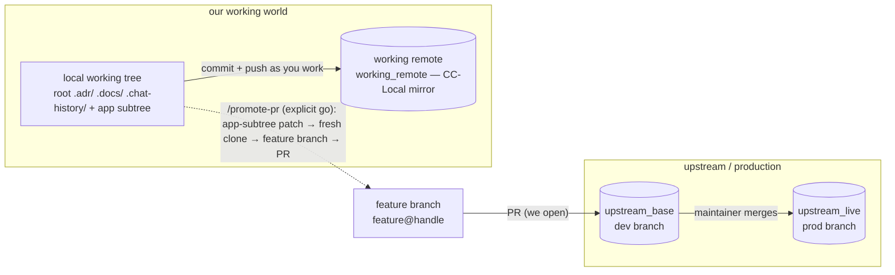

# Runbook — Contributor Conventions

> **What this is:** the rules an AI agent (Claude Code / Codex) follows on a repo where **we are a
> contributor, not the sole owner** — so day-to-day work stays fast on our own remote while the
> upstream/production repo is only ever touched deliberately, as a PR, on explicit request.
> **Audience:** you (the repo owner) + any AI agent.
> **Status:** ✅ Active. Companion to the **device-sync** convention
> (`device-sync-and-handoff-protocol.md`): that one says *which branch on this machine*; this one says
> *what our relationship to this repo is* and therefore *where a push may go*.
> **Applies ONLY when `repo.local.md` declares `contributor`.** On an `owner` repo it is inert.

---

## TL;DR

```
Declare once   →  /declare-repo <owner|contributor> [working=… upstream=… base=… live=… subtree=…]
Work           →  contributor: commit + push AS YOU WORK, but ONLY to the working remote
                  owner:       commit + push everywhere as normal (conventions inert)
Promote (rare) →  /promote-pr <feature> [<base>]   → feature-branch PR into the upstream dev branch
                  ...runs ONLY on an explicit user request AND when the feature is complete.
                  A PR proposes; the maintainer merges. We never push straight to dev/live.
```

## Ownership model (read `repo.local.md` first)

`repo.local.md` lives at the repo root, sibling to `device.local.md`, tracked + committed.

| Section 1 checkbox | Meaning | Behavior |
|---|---|---|
| `owner` | sole dev/owner | contributor-conventions **do NOT apply** — commit + push everywhere as normal |
| `contributor` | we contribute; someone else owns upstream | two-remote model below is in force |
| neither / missing | undeclared | **fail-safe to `contributor`** (stricter hold); run `/declare-repo` |

Fields the workflow reads: `working_remote` / `working_repo_id`, `upstream_remote` /
`upstream_repo_id`, `upstream_base` (PR dev branch), `upstream_live` (maintainer-only prod branch),
`app_subtree` (path mapping to the upstream repo root, e.g. `CC/`).

## The two-remote model

| Remote | Structure | Role | When we push |
|---|---|---|---|
| **Working remote** (`working_remote`) | full CC-Local-style mirror: root `.adr/` `.docs/` `.chat-history/` + the app subtree | DEFAULT push target; owner-style fast flow | commit + push as you work |
| **Upstream / production** (`upstream_remote`) | the product repo (app only) | read-only from our side | HOLD until explicit request + PR-ready, then a feature-branch PR into `upstream_base` |

- **Every contributor repo gets its own working-remote mirror** — a same-structure CC-Local-style repo
  we create and write into `repo.local.md` as `working_remote` **as soon as it exists.** We iterate and
  validate there first; promotion to upstream comes later, on explicit direction.
- **Only the app subtree** (`app_subtree`) is upstream-relevant. Root `.adr/` `.docs/` `.chat-history/`
  are ours and **never** go upstream. Everything upstream stays **additive / non-breaking**.

- **Maintainer-facing docs MUST ship inside the app subtree (`<app_subtree>/.app-docs/`).** Anything the
  **maintainer/prod-admin** has to read — activation/keys checklists, integration guides, user guides — is written as
  **real content under `<app_subtree>/.app-docs/`** so it travels in the patch and lands in the product repo. The
  CC-Local **PR kit** at `.docs/pr/<feature>/` is the **contributor's** toolkit only; its `README.md` + generated
  `.patch` **never ship**, and any maintainer-facing file in it (e.g. `keys-explained.md`) must be a **symlink to the
  canonical `.app-docs/` copy** — never the source of truth. Rule of thumb: *if the maintainer needs it, it lives in
  `.app-docs/`; if only we (the contributor pushing the PR) need it, it lives in `.docs/pr/`.* The PR body (from
  `PR-DESCRIPTION.md`) reaches them on the PR page; `.app-docs/` reaches them in the merged code.



---

## 1. Declare the repo (`/declare-repo`)

Run once per repo (or to update remotes). Writes/updates `repo.local.md`.

```
/declare-repo contributor \
  working=https://github.com/pelchers/CC-Local.git \
  upstream=https://github.com/fmchisti/collectibleclassics.git \
  base=website@dev live=website@live subtree=CC/
```
or, for a repo we own:
```
/declare-repo owner
```
- Section 1 gets exactly one box checked; Sections 2–3 record the remotes.
- Updating an existing file preserves unspecified fields — never blow away a filled-in remote.
- Keep the file tracked (no-ignore policy). It is per-repo, like `device.local.md` is per-device.

## 2. Work day-to-day

**Contributor repo:** commit + push exactly as on an owner repo — **but only to `working_remote`.**
Nothing goes to `upstream_remote` during development. The whole point of the working-remote mirror is
that the fast owner-style flow is safe there.

**Owner repo:** the conventions are inert; commit + push everywhere as normal.

## 3. Promote to upstream (`/promote-pr`) — explicit request ONLY

The **only** way we push to the upstream/production repo, and it runs **only** when the user explicitly
says so (e.g. "push the PR now") AND the feature is PR-ready/complete. Executed by `/promote-pr` or the
`contributor-promotion-agent`:

```mermaid
sequenceDiagram
  participant U as User
  participant A as Agent (/promote-pr)
  participant Up as Upstream repo
  U->>A: "push the PR now" (feature complete)
  A->>A: gate: repo.local.md=contributor? explicit? complete?
  A->>A: build <app_subtree>-relative additive patch (.docs/pr/<feature>/)
  A->>Up: clone fresh (scratch dir)
  A->>Up: checkout upstream_base → branch feature@handle
  A->>A: git apply --3way → union additive conflicts
  A->>A: typecheck via turbo (green)
  A->>Up: CONTRIBUTOR_PUSH_OK=1 git push feature@handle (feature branch only)
  A->>Up: open PR into upstream_base (body → integration guide)
  Note over A,Up: STOP — a PR proposes; the maintainer merges
```

**Steps:**
1. **Gate** — `repo.local.md` = `contributor`; this invocation is the explicit request; feature complete.
2. **Patch** — `<app_subtree>`-relative additive patch under `.docs/pr/<feature>/` (app subtree only;
   root `.adr/` `.docs/` `.chat-history/` excluded).
3. **Clone upstream fresh** into a scratch dir (never the working tree).
4. **Branch off current dev** — `git checkout <upstream_base>` then `git checkout -b <feature>@<handle>`.
5. **Apply + resolve** — `git apply --3way`; resolve conflicts by **unioning the additive edits** (keep
   both sides; never delete/reformat existing upstream code).
6. **Typecheck** — `turbo run typecheck`/`build`, green before pushing.
7. **Push the feature branch** — `CONTRIBUTOR_PUSH_OK=1 git push <upstream> <feature>@<handle>`
   (feature branch only — never `upstream_base` / `upstream_live`).
8. **Open a PR** — into `upstream_base`, via `gh pr create` / the GitHub API / a surfaced compare URL;
   PR body points to the feature's integration guide.
9. **Stop** — do not merge. A PR proposes; the maintainer merges dev → live.

---

## 4. Layered assurance (why this is safe)

| Layer | Piece | Role |
|---|---|---|
| **1. Declaration** | `repo.local.md` | single source of truth: owner vs contributor + the remotes |
| **2. SessionStart banner** | `contributor-repo-check.sh` | announces a contributor repo + the safe default push target |
| **3. Pre-push guard** | `contributor-push-guard.sh` (fail-open) | blocks an accidental upstream push lacking `CONTRIBUTOR_PUSH_OK=1` |
| **4. Skill** | `contributor-conventions` | the behavior the agent follows (makes the right thing the default) |
| **5. Governance** | one-line pointer in `CLAUDE.md` · `.claude/CLAUDE.md` · `.codex/CODEX.md` · `.codex/AGENTS.md` · `git-workflow-agent` | inherited by every agent that loads those files |

**Escape hatch:** a deliberately-authorized upstream push carries `CONTRIBUTOR_PUSH_OK=1`; only
`/promote-pr` / `contributor-promotion-agent` set it, and only on an explicit request. Working-remote
pushes are never touched by the guard.

> **The two hook scripts + their `settings.json` registration are ORCHESTRATOR-OWNED (safety-critical)**
> and are **not** built by this component. They are specified precisely in
> `.codex/system_docs/contributor_conventions/HOOKS-TODO.md`. The skill + declaration file govern
> behavior until the hooks are wired; the hooks are the automated backstop.

## 5. What each piece is (component map)

| Piece | Path | Role |
|---|---|---|
| **declaration** | `repo.local.md` (repo root, tracked) | owner vs contributor + remotes |
| **template** | `.other-devices/components/contributor-conventions/artifacts/repo.local.md.template` | placeholder starting point |
| **skill** `contributor-conventions` | `.claude/skills/contributor-conventions/SKILL.md` (+ `.codex/`) | the behavior an agent follows |
| **command** `/promote-pr` | `.claude/commands/promote-pr.md` (+ `.codex/`) | run the promotion (explicit go only) |
| **command** `/declare-repo` | `.claude/commands/declare-repo.md` (+ `.codex/`) | create/update `repo.local.md` |
| **agent** `contributor-promotion-agent` | `.claude/agents/contributor-promotion-agent/` (+ `.codex/`) | executes the promotion autonomously |
| **hook** (SessionStart) | `.claude/hooks/scripts/contributor-repo-check.sh` (+ `.codex/`) | banner — **orchestrator-owned** |
| **hook** (PreToolUse) | `.claude/hooks/scripts/contributor-push-guard.sh` (+ `.codex/`) | fail-open guard — **orchestrator-owned** |
| **convention line** | `production-pr-on-request` block in the instruction files + git-workflow-agent | governance pointer |
| **this runbook** | `.docs/runbooks/development/contributor-conventions.md` | the full explanation |
| **system docs** | `.codex/system_docs/contributor_conventions/` (README · USAGE_GUIDE · ARCHITECTURE · HOOKS-TODO) | component reference |
| **staged package** | `.other-devices/components/contributor-conventions/` | portable copy for other repos |

## 6. Relationship to other conventions

- **`device-sync-protocol`** — resolves *which branch on this machine*; this resolves *which
  relationship to this repo*. Both read a tracked `*.local.md` sibling at the repo root.
- **`production-pr-on-request` convention block** — the general house rule this component operationalizes
  into a skill + agent + commands + declaration file + hooks. The block carries a one-line pointer to
  this component.
- **`git-workflow-agent`** — inherits that one-line pointer so its commit/push behavior respects the
  contributor gate.

## 7. Validation checklist (after any change to this component)

- [ ] `repo.local.md` present at the repo root, tracked, with exactly one ownership box checked.
- [ ] `/declare-repo` writes/updates `repo.local.md` and preserves unspecified fields.
- [ ] `/promote-pr` gate refuses on `owner` / no-explicit-request / mid-flight; on go, runs
      patch → fresh clone → feature branch → PR into `upstream_base` (never dev/live directly).
- [ ] `.claude` ⇄ `.codex` mirrors aligned (skill, both commands, agent); system_docs present.
- [ ] Orchestrator has built + wired + tested the two hooks (see `HOOKS-TODO.md`).
- [ ] One-line governance pointer present in all five instruction/agent files.

## 8. Related

- `device-sync-and-handoff-protocol.md` — which branch each device commits to.
- `repo.local.md` — the per-repo ownership + remotes declaration.
- `/declare-repo`, `/promote-pr` — the commands.
- Portable package: `.other-devices/components/contributor-conventions/`.
